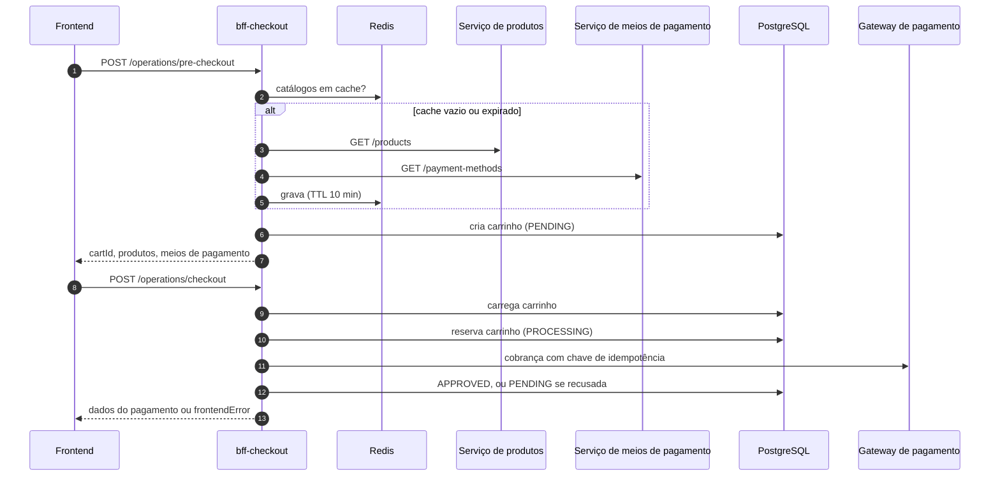
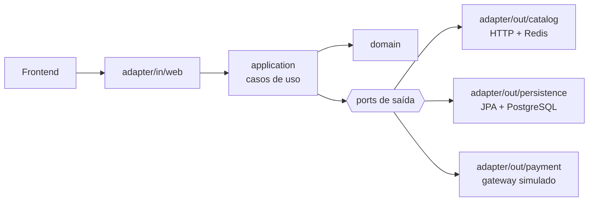

# bff-checkout

BFF (Backend for Frontend) do checkout de assinaturas. É a API por trás das telas de pagamento, sucesso e erro: ela
busca produtos e meios de pagamento nos serviços que são donos desses dados e entrega para o frontend só o que cada
tela usa. Qualquer erro volta no mesmo formato, para o frontend não precisar tratar casos especiais.

## Sumário

- [Visão geral](#visão-geral)
- [Stack](#stack)
- [Pré-requisitos](#pré-requisitos)
- [Executando](#executando)
- [Configuração](#configuração)
- [API](#api)
- [Contrato de erro](#contrato-de-erro)
- [Cache](#cache)
- [Operação](#operação)
- [Testes](#testes)
- [Arquitetura](#arquitetura)
- [Solução de problemas](#solução-de-problemas)

## Visão geral

O checkout acontece em duas chamadas. No pré-checkout o frontend manda os planos escolhidos, o BFF confere se eles
existem no catálogo e cria um carrinho com os meios de pagamento disponíveis. No checkout ele manda o carrinho e o
meio escolhido, e o BFF valida tudo e faz a cobrança, que pode ser aprovada ou recusada.



Os serviços de produtos e de meios de pagamento são mocks servidos pela própria aplicação em `/mock/**`,
e o gateway de pagamento também é simulado. Para trocar pelos serviços de verdade, aponte `PRODUCTS_URL` e
`PAYMENT_METHODS_URL` para eles e substitua o adapter do gateway.

## Stack

Java 21 e Spring Boot 4.2 (Web MVC, Data JPA, Validation, Cache e RestClient). Os dados ficam no PostgreSQL 16, com
migrations no Flyway, e os catálogos ficam em cache no Redis 7. A documentação da API é gerada pelo springdoc-openapi 3.
Os testes usam JUnit 5, Mockito, AssertJ e Testcontainers. O build é feito pelo Maven Wrapper e a aplicação roda com
Docker Compose.

## Pré-requisitos

- Docker com Docker Compose (Docker Desktop, Colima ou outro)
- Java 21, se for rodar fora do Docker ou executar os testes

## Executando

### Docker Compose

O jeito mais rápido. Sobe a aplicação, o PostgreSQL e o Redis de uma vez:

```bash
docker compose up --build
```

A API responde em http://localhost:8080 e o Swagger UI fica em http://localhost:8080/swagger-ui.html. O PostgreSQL
fica exposto em `localhost:5432` (banco, usuário e senha são `checkout`) e o Redis em `localhost:6379`.

Para parar e apagar os dados:

```bash
docker compose down -v
```

### Localmente

Se preferir rodar a aplicação pelo Maven, suba só a infraestrutura no Docker:

```bash
docker compose up -d postgres redis
./mvnw spring-boot:run
```

O Flyway cria o schema do banco na inicialização, a partir de `src/main/resources/db/migration`.

### Build

```bash
./mvnw clean package
java -jar target/bff-checkout-0.0.1-SNAPSHOT.jar
```

## Configuração

Os valores padrão servem para desenvolvimento local. Em outros ambientes, sobrescreva com variáveis de ambiente.

| Variável | Padrão | Descrição |
|---|---|---|
| `PORT` | `8080` | Porta HTTP |
| `DB_URL` | `jdbc:postgresql://localhost:5432/checkout` | URL JDBC do PostgreSQL |
| `DB_USER` | `checkout` | Usuário do banco |
| `DB_PASSWORD` | `checkout` | Senha do banco |
| `REDIS_HOST` | `localhost` | Host do Redis |
| `REDIS_PORT` | `6379` | Porta do Redis |
| `PRODUCTS_URL` | `http://localhost:${PORT}/mock` | URL base do serviço de produtos |
| `PAYMENT_METHODS_URL` | `http://localhost:${PORT}/mock` | URL base do serviço de meios de pagamento |
| `SPRING_CACHE_REDIS_TIMETOLIVE` | `10m` | Tempo de vida do cache dos catálogos |
| `SPRING_CACHE_TYPE` | `redis` | Use `none` para desligar o cache |
| `SPRING_HTTP_CLIENTS_CONNECT_TIMEOUT` | `2s` | Timeout de conexão com os serviços de catálogo |
| `SPRING_HTTP_CLIENTS_READ_TIMEOUT` | `5s` | Timeout de leitura dos serviços de catálogo |
| `SPRING_DATA_REDIS_TIMEOUT` | `500ms` | Timeout dos comandos no Redis |
| `LOGGING_STRUCTURED_FORMAT_CONSOLE` | (vazio) | `ecs` para logs em JSON. O Docker Compose já liga |
| `CHECKOUT_PAYMENT_PROCESSING_TIMEOUT` | `2m` | Depois desse tempo, um pagamento interrompido no meio pode ser tentado de novo |

## API

São dois endpoints:

| Método | Endpoint | Descrição |
|---|---|---|
| `POST` | `/operations/pre-checkout` | Cria o carrinho a partir dos planos escolhidos |
| `POST` | `/operations/checkout` | Processa o pagamento do carrinho |

A referência completa, com exemplos de requisição e de cada erro, está no Swagger UI (`/swagger-ui.html`). Se você
precisa da especificação OpenAPI em JSON, ela fica em `/v3/api-docs`.

### Pré-checkout

```bash
curl -X POST http://localhost:8080/operations/pre-checkout \
  -H 'Content-Type: application/json' \
  -d '{"products": [{"slug": "premium"}]}'
```

```json
{
  "cartId": "5a7ed441-567e-4f63-825e-dbdf07e640d6",
  "products": [
    {
      "slug": "premium",
      "name": "Plano Premium",
      "description": "Assinatura mensal com catálogo completo",
      "price": 39.90,
      "currency": "BRL"
    }
  ],
  "paymentMethods": [{"name": "Cartão de Crédito"}, {"name": "Cartão de Débito"}, {"name": "Pix"}]
}
```

O catálogo tem três planos: `basico` (R$ 19,90), `premium` (R$ 39,90) e `familia` (R$ 59,90). Um mesmo plano não pode
aparecer duas vezes no carrinho.

### Checkout

Pagando com cartão:

```bash
curl -X POST http://localhost:8080/operations/checkout \
  -H 'Content-Type: application/json' \
  -d '{
    "cartId": "5a7ed441-567e-4f63-825e-dbdf07e640d6",
    "paymentMethod": {
      "name": "Cartão de Crédito",
      "card": {"holderName": "Ana Souza", "number": "4111111111114242", "expiry": "12/35", "cvv": "123"}
    }
  }'
```

```json
{
  "cartId": "5a7ed441-567e-4f63-825e-dbdf07e640d6",
  "status": "APROVADO",
  "paidAt": "2026-11-22T16:14:50.564Z",
  "payment": {"method": "Cartão de Crédito", "lastDigits": "4242", "amount": 39.90, "currency": "BRL"},
  "products": [{"slug": "premium", "name": "Plano Premium", "price": 39.90}]
}
```

Com Pix não se envia o objeto `card`. A resposta é a mesma, com `pixCode` no lugar de `lastDigits`:

```bash
curl -X POST http://localhost:8080/operations/checkout \
  -H 'Content-Type: application/json' \
  -d '{"cartId": "5a7ed441-567e-4f63-825e-dbdf07e640d6", "paymentMethod": {"name": "Pix"}}'
```

O BFF não grava o número completo do cartão nem o CVV, e esses dados também não aparecem nos logs. No banco ficam
apenas os quatro últimos dígitos.

### Simulação de cenários

Como o gateway é simulado, dá para reproduzir cada cenário só escolhendo os dados certos:

| Cenário | Como reproduzir | Resultado |
|---|---|---|
| Pagamento aprovado | Cartão válido que não termine em `0002` (ex.: `4111111111114242`) ou Pix | `200` |
| Pagamento recusado | Cartão terminado em `0002` (ex.: `4111111111110002`) | `422 PAYMENT_DECLINED` |
| Pagamento duplicado | Repetir o checkout de um carrinho já aprovado | `409 CART_ALREADY_PAID` |
| Carrinho inexistente | `cartId` que não veio do pré-checkout | `404 CART_NOT_FOUND` |
| Produto inexistente | Slug fora do catálogo no pré-checkout | `404 PRODUCT_NOT_FOUND` |
| Cartão vencido | `expiry` anterior ao mês atual (ex.: `01/20`) | `400 INVALID_PAYMENT_DATA` |

Uma recusa não fecha o carrinho. Ele continua pendente e aceita outra tentativa, com outro cartão ou com Pix.

### Como a cobrança dupla é evitada

Antes de chamar o gateway, o checkout muda o carrinho para `PROCESSING` e grava. Essa gravação passa pelo lock
otimista (`@Version`), então só uma de duas requisições simultâneas consegue reservar o carrinho; a outra recebe
`409 PAYMENT_IN_PROGRESS` e não chega a cobrar.

Cada cobrança vai para o gateway com uma chave de idempotência no formato `<cartId>:<tentativa>`. Uma recusa abre a
tentativa seguinte, porque o próximo cartão é uma cobrança nova. Já uma falha técnica (timeout, gateway fora do ar)
devolve o carrinho para `PENDING` com a mesma tentativa: se a cobrança chegou a passar, repetir com a mesma chave
devolve o resultado original em vez de cobrar de novo. Se a aplicação cair no meio, o carrinho fica em `PROCESSING` e
volta a aceitar tentativas depois de `CHECKOUT_PAYMENT_PROCESSING_TIMEOUT`, também com a mesma chave.

## Contrato de erro

Todo erro que o frontend exibe chega neste formato. Os campos são sempre os mesmos: quando um deles não tem valor, ele
vem como `null` em vez de sumir da resposta.

```json
{
  "displayType": "BLOCK",
  "errorCode": "PAYMENT_DECLINED",
  "cartId": "5a7ed441-567e-4f63-825e-dbdf07e640d6",
  "frontendError": {
    "code": "P-1001",
    "title": "Pagamento não aprovado",
    "description": "Não foi possível concluir o pagamento. Tente novamente ou escolha outro meio.",
    "primaryButton": {"label": "Tentar novamente", "url": "RETRY"},
    "secondaryButton": {"label": "Trocar meio de pagamento", "url": "/checkout/pagamento"}
  }
}
```

`displayType` diz como a tela deve reagir. `BLOCK` é um erro de tela, com ações para o usuário, e `INTERVENTION` é um
aviso que não interrompe o fluxo. A `url` dos botões é uma rota do frontend ou a ação `RETRY`, que repete a última
operação.

| errorCode | HTTP | displayType | code | Quando ocorre |
|---|---|---|---|---|
| `INVALID_REQUEST` | 400 | INTERVENTION | P-0001 | JSON malformado ou campo obrigatório ausente |
| `PAYMENT_DECLINED` | 422 | BLOCK | P-1001 | Pagamento recusado pelo gateway |
| `INVALID_PAYMENT_METHOD` | 422 | INTERVENTION | P-1002 | Meio de pagamento não oferecido para o carrinho |
| `INVALID_PAYMENT_DATA` | 400 | INTERVENTION | P-1003 | Cartão ausente, inválido ou vencido, ou Pix com dados de cartão |
| `PRODUCT_NOT_FOUND` | 404 | BLOCK | P-2001 | Slug inexistente no catálogo |
| `DUPLICATE_PRODUCT` | 400 | INTERVENTION | P-2002 | Mesmo plano mais de uma vez no pré-checkout |
| `CART_NOT_FOUND` | 404 | BLOCK | P-3001 | Carrinho não criado no pré-checkout |
| `CART_ALREADY_PAID` | 409 | BLOCK | P-3002 | Carrinho já aprovado |
| `PAYMENT_IN_PROGRESS` | 409 | BLOCK | P-3003 | Outra requisição está cobrando o mesmo carrinho |
| `SERVICE_UNAVAILABLE` | 503 | BLOCK | P-9001 | Serviço de produtos ou de meios de pagamento indisponível |
| `INTERNAL_ERROR` | 500 | BLOCK | P-9002 | Erro não previsto |

Títulos, descrições e botões estão em `adapter/in/web/error/FrontendErrorCatalog.java`. O domínio não sabe nada
disso, só conhece o `ErrorCode`.

## Cache

O pré-checkout consulta os dois catálogos toda vez, e eles quase não mudam, então ficam em cache no Redis. Cada um
ocupa uma chave só, com a lista inteira que o serviço devolveu: `products::SimpleKey []` para os produtos e
`paymentMethods::SimpleKey []` para os meios de pagamento.

As entradas expiram em 10 minutos e não há invalidação ativa, então uma mudança no catálogo pode levar até 10 minutos
para aparecer. Os carrinhos que já existem não mudam com isso, porque cada um guarda uma cópia dos produtos e preços
do momento em que foi criado. Quando um serviço responde com erro, nada é gravado e a próxima requisição tenta de
novo. Carrinhos e pagamentos não passam pelo cache, ficam só no PostgreSQL.

Para olhar ou limpar o cache:

```bash
docker compose exec redis redis-cli keys '*'                       # lista as chaves
docker compose exec redis redis-cli ttl 'products::SimpleKey []'   # segundos até expirar
docker compose exec redis redis-cli flushdb                        # limpa o cache
```

Se o Redis cair, a aplicação continua funcionando sem cache: cada leitura vira um cache miss e o catálogo é buscado
direto nos serviços, e as gravações no cache são ignoradas. A falha aparece só no log, como `WARN`.

Para as requisições não pagarem o timeout do Redis (`SPRING_DATA_REDIS_TIMEOUT`, 500 ms) a cada chamada, o cache fica
atrás de um circuit breaker (Resilience4j). Quando metade das últimas chamadas falha, com pelo menos 4 chamadas na
janela, o circuito abre e o Redis deixa de ser consultado por 30 segundos. Passado esse tempo, duas chamadas de teste
decidem se ele volta a ser usado. Cada mudança de estado gera um `WARN` com o texto `Circuit breaker do cache`.
Esses limites ficam em `checkout.cache.circuit-breaker` no `application.yaml` e podem ser sobrescritos por variável
de ambiente, por exemplo `CHECKOUT_CACHE_CIRCUITBREAKER_WAITDURATIONINOPENSTATE=1m`.

## Operação

O Actuator expõe só `health`, `info` e `metrics`:

| Endpoint | Uso |
|---|---|
| `/actuator/health/liveness` | Probe de liveness. Não olha banco nem Redis, para uma queda deles não reiniciar o pod |
| `/actuator/health/readiness` | Probe de readiness. Fica `DOWN` (503) se o PostgreSQL cair, e a instância sai do balanceamento. O Redis fica de fora de propósito, já que sem cache a aplicação continua atendendo |
| `/actuator/metrics` | Métricas do Micrometer (requisições HTTP, JVM, pool de conexões) |

No Docker Compose os logs saem em JSON no formato ECS, prontos para Elasticsearch, Loki ou Datadog. Rodando pelo
Maven continuam em texto, que é mais fácil de ler no terminal.

Cada requisição recebe um id, que aparece no campo `requestId` de todos os logs dela e volta no header
`X-Request-Id` da resposta. Se a chamada já chegar com `X-Request-Id` (do frontend ou de um gateway de API), o BFF usa
esse valor; ids com caracteres fora de `[A-Za-z0-9._-]` ou com mais de 64 caracteres são trocados por um novo, para
ninguém injetar texto nos logs.

## Testes

```bash
./mvnw test                                                  # todos os testes
./mvnw test -Dtest='!*IntegrationTest'                       # só os unitários, sem Docker
./mvnw test -Dtest=CheckoutServiceTest                       # uma classe
```

Os testes de integração sobem PostgreSQL e Redis com Testcontainers, então o Docker precisa estar rodando. Os
unitários não dependem de nada externo.

Os testes de domínio (`CardTest` e `CartTest`) cobrem a validação e o vencimento do cartão, o mascaramento do número e
as regras de aprovação do carrinho. `PreCheckoutServiceTest` e `CheckoutServiceTest` testam as regras de negócio com os
ports mockados. Nos adapters, `CatalogHttpAdaptersTest` verifica a chamada HTTP aos catálogos (inclusive com o serviço
fora do ar), `SimulatedPaymentGatewayAdapterTest` a cobrança simulada e `GlobalExceptionHandlerTest` o contrato de erro.

`OperationsControllerIntegrationTest` faz o fluxo HTTP completo contra PostgreSQL e Redis reais. Ele passa por todos os
erros do contrato, pelo cache, por dois pagamentos simultâneos no mesmo carrinho, pelo lock otimista, pelos
health checks, pelo `X-Request-Id` e pela documentação OpenAPI. `RedisOutageIntegrationTest` sobe a aplicação com o
Redis apontando para uma porta fechada e confere que o pré-checkout e a readiness continuam respondendo.

## Arquitetura

O projeto segue a arquitetura hexagonal (ports and adapters). Domínio e casos de uso não dependem do Spring nem de
nenhum outro framework; cada tecnologia fica no seu próprio adapter.



```
src/main/java/com/larissafalcao/bff_checkout
├── domain
│   ├── model             Cart, Payment, Product, PaymentMethod, Card, ChargeResult
│   └── exception         CheckoutException, ErrorCode
├── application
│   ├── port/in           PreCheckoutUseCase, CheckoutUseCase, CheckoutCommand
│   ├── port/out          ProductCatalogPort, PaymentMethodCatalogPort, CartRepositoryPort, PaymentGatewayPort
│   └── service           PreCheckoutService, CheckoutService
├── adapter
│   ├── in/web            OperationsController e DTOs
│   ├── in/web/filter     RequestIdFilter (id de correlação nos logs)
│   ├── in/web/error      GlobalExceptionHandler, ErrorResponse, FrontendErrorCatalog
│   ├── in/web/openapi    Documentação OpenAPI (OperationsApi e exemplos)
│   ├── out/cache         Circuit breaker na frente do Redis
│   ├── out/catalog       Cliente HTTP dos catálogos, com cache
│   ├── out/persistence   Entidades JPA, repositório e mapeamento para o domínio
│   └── out/payment       Gateway de pagamento simulado
├── config                Ligação dos casos de uso aos adapters, metadados do OpenAPI
└── mockserver            Serviços de produtos e de meios de pagamento simulados (/mock/**)
```

## Solução de problemas

### `Could not find a valid Docker environment` nos testes

O Testcontainers procura o Docker em `/var/run/docker.sock`. Quem usa Colima tem o socket em outro lugar, e o jeito
mais simples é apontar o caminho padrão para ele:

```bash
sudo ln -sf ~/.colima/default/docker.sock /var/run/docker.sock
```

Se não quiser mexer no socket do sistema, exporte estas variáveis antes de rodar os testes:

```bash
export DOCKER_HOST=unix://$HOME/.colima/default/docker.sock
export TESTCONTAINERS_DOCKER_SOCKET_OVERRIDE=/var/run/docker.sock
```

### Porta 5432, 6379 ou 8080 ocupada

Algum PostgreSQL, Redis ou outra aplicação local já está usando a porta. Pare o processo ou mude o mapeamento no
`docker-compose.yml`. A porta da aplicação também pode ser trocada com `PORT`.
